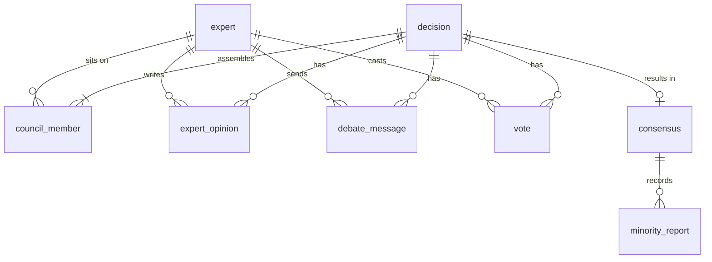

# Database Design

Schema source of truth for the MVP. PostgreSQL with Drizzle ORM ([Data and Infrastructure](tech-stack/05-data-and-infrastructure.md)). The earlier sketches in [Database Models](project-structure/07-database-models.md) and the [MVP schema](../40-planning/mvp-plan/03-database-schema.md) link here.

Design choices are recorded in [ADR-013](../90-records/decisions/02-mvp-design.md#adr-013-mvp-database-schema). The MVP is used through the CLI by one local operator, so accounts and ownership wait for the web app ([ADR-018](../90-records/decisions/02-mvp-design.md#adr-018-the-mvp-is-a-headless-engine-with-a-cli)).

---

## Conventions

- Tables and columns are `snake_case` in PostgreSQL and `camelCase` in TypeScript through Drizzle.
- Primary keys are UUIDv7, generated by the application, so they sort by creation time. The exception is `expert.id`, a stable slug such as `engineering/database-engineer`.
- Timestamps are `timestamptz` in UTC.
- Scores (`confidence`, `agreement`, `weight`, `rank_score`) are `real` from 0 to 1. The interface may display them as percentages.
- Enums are PostgreSQL enums defined in Drizzle, so values are type-checked on both sides.
- Lists that are only read with their parent (`domains`, `tradeoffs`, `risks`) use `text[]`. `jsonb` is used only for `decision.context`, which has no fixed shape.

---

## Entities

| Table | Purpose | Key columns | Requirement |
| --- | --- | --- | --- |
| `decision` | One submitted question and its lifecycle | `id`, `title`, `description`, `category`, `impact`, `reasoning_depth`, `domains`, `status`, `context`, `failure_reason`, `approved_at`, `created_at`, `updated_at` | FR-001 to FR-007, FR-019 |
| `expert` | Catalog of experts synced from `experts/` at startup | `id`, `name`, `domain`, `kind`, `is_permanent`, `default_weight`, `version` | FR-008 |
| `council_member` | Which experts sat on a decision's council, and why | `decision_id`, `expert_id`, `expert_version`, `role`, `rank_score`, `weight` | FR-009 to FR-014 |
| `expert_opinion` | An expert's analysis, initial or revised | `id`, `decision_id`, `expert_id`, `stage`, `recommendation`, `reasoning`, `confidence`, `risks`, `alternatives`, `created_at` | FR-015 |
| `debate_message` | One critique or response in a debate round | `id`, `decision_id`, `expert_id`, `round`, `kind`, `target_expert_id`, `content`, `created_at` | FR-016 |
| `vote` | An expert's final vote | `decision_id`, `expert_id`, `choice`, `confidence`, `weight`, `created_at` | FR-017 |
| `consensus` | The final result of a decision | `id`, `decision_id`, `final_decision`, `reasoning`, `confidence`, `agreement`, `tradeoffs`, `risks`, `created_at` | FR-018 |
| `minority_report` | One dissenting position from the consensus | `id`, `consensus_id`, `expert_ids`, `position`, `reasoning` | FR-018 |

### Enums

| Enum | Values |
| --- | --- |
| `decision_category` | `ARCHITECTURE`, `TECH_STACK`, `DATABASE`, `SECURITY`, `INFRASTRUCTURE`, `PRODUCT`, `UX`, `UI`, `BUSINESS`, `MARKETING`, `CODE`, `REFACTORING`, `TESTING`, `AI`, `OTHER` ([Decision Categories](../30-specs/decision-engine/02-lifecycle-object-categories.md#decision-categories)) |
| `impact_level` | `LOW`, `MEDIUM`, `HIGH` |
| `reasoning_depth` | `SHALLOW`, `STANDARD`, `DEEP` |
| `decision_status` | `CREATED`, `CLASSIFIED`, `CONTEXT_LOADED`, `COUNCIL_SELECTED`, `EXPERT_ANALYSIS`, `DEBATE`, `VOTING`, `CONSENSUS`, `APPROVED`, `STORED`, `FAILED`, `REJECTED` ([ADR-014](../90-records/decisions/02-mvp-design.md#adr-014-mvp-decision-run-orchestration), [ADR-010](../90-records/decisions/02-mvp-design.md#adr-010-mvp-decision-lifecycle-ends-at-stored-with-human-approval-for-high-impact)) |
| `expert_kind` | `built-in` (only value used in the MVP), `custom`, `eve-agent` ([Expert Structure](project-structure/06-expert-structure.md)) |
| `council_role` | `required`, `permanent` |
| `opinion_stage` | `initial`, `revised` |
| `debate_message_kind` | `critique`, `response` |

### Column notes

- `decision.status` is `FAILED` when a run cannot reach consensus; `failure_reason` says why. This feeds the Technical success metric ([ADR-012](../90-records/decisions/02-mvp-design.md#adr-012-measurable-mvp-success-targets)).
- `decision.approved_at` is set when the operator confirms or rejects a high-impact decision. It stays null for low and medium impact.
- `decision.status` is `REJECTED` when the operator rejects a high-impact decision; `failure_reason` records it.
- `expert.version` is a content hash of the expert's files. `council_member.expert_version` copies it, so every stored decision shows exactly which version of an expert took part.
- `council_member.weight` is the weight actually applied in voting for this decision. How it is computed belongs to the [consensus engine](../30-specs/decision-engine/07-consensus-engine.md); the schema only stores the result.
- `vote.choice` is the option the expert backs. Votes are grouped by `choice` to compute agreement.
- Prompts are not stored in the database. They live in each expert's `SYSTEM.md`.

---

## Relationships

- `council_member` has primary key (`decision_id`, `expert_id`). `vote` has primary key (`decision_id`, `expert_id`): one final vote per expert per decision.
- `expert_opinion`, `debate_message`, and `vote` reference an expert that must also be in `council_member` for the same decision. The engine enforces this.
- `consensus.decision_id` is unique: one consensus per decision.
- All foreign keys use `ON DELETE RESTRICT`. Decision history is never removed by cascading deletes ([NFR-006](../00-product/requirements.md#non-functional-requirements)).
- Rows in `council_member`, `expert_opinion`, `debate_message`, `vote`, `consensus`, and `minority_report` are insert-only. Only `decision` is updated as it moves through its lifecycle.

---

## Indexes

| Table | Index | Serves |
| --- | --- | --- |
| `decision` | (`created_at` desc) | Listing decision history |
| `decision` | partial on `status` where status is not `STORED`, `FAILED`, or `REJECTED` | `resume` and listing decisions awaiting approval |
| `decision` | GIN on a generated `tsvector` of `title` and `description` | Full-text search over past decisions |
| `expert_opinion` | (`decision_id`, `stage`) | Loading opinions for debate and the report |
| `debate_message` | (`decision_id`, `round`) | Replaying a debate in order |
| `minority_report` | (`consensus_id`) | Loading the report |

Primary keys and the unique constraint on `consensus.decision_id` cover the remaining lookups. Search uses PostgreSQL full-text search, and no vector index is added in the MVP ([ADR-008](../90-records/decisions/01-foundations.md#adr-008-defer-infrastructure-until-it-is-needed)).

---

## Not in the MVP schema

| Entity | Arrives with |
| --- | --- |
| `user` (Better Auth, with `session`, `account`, `verification`), `decision.user_id`, `decision.approved_by` | [Web app and API](../00-product/roadmap/03-phase-2-advanced-decision-engine.md#web-app-and-api), [ADR-018](../90-records/decisions/02-mvp-design.md#adr-018-the-mvp-is-a-headless-engine-with-a-cli) |
| `project`, and `decision.project_id` as a nullable foreign key | [Phase 3 — Project Intelligence](../00-product/roadmap/05-phase-3-project-intelligence.md) |
| `artifact` | [Phase 4 — Project Architect](../00-product/roadmap/06-phase-4-project-architect.md) |
| `workflow`, `execution`, and the `EXECUTED` and `EVALUATED` statuses | [Phase 6 — Eve Integration](../00-product/roadmap/07-phase-5-6-github-and-eve.md) |
| Decision dependencies (decision graph) | [Phase 3 — Project Intelligence](../00-product/roadmap/05-phase-3-project-intelligence.md#decision-graph) |
| Outcome tracking (prediction versus reality) | Not yet placed in the roadmap; listed as V2 in [Future Improvements](../30-specs/decision-engine/10-mvp-and-future.md#future-improvements) |

Blind-rating data from `eval` ([FR-023](../00-product/requirements.md#evaluation)) lives in files, not in these tables.

---

## Migration policy

- Migrations are SQL files generated by `drizzle-kit generate` from the Drizzle schema, committed with the schema change, and reviewed in the same pull request.
- `drizzle-kit push` is for local development only and never runs against shared databases.
- Applied migrations are never edited. Every fix is a new migration.
- Migrations are forward-only. Breaking changes follow expand and contract: add the new column or table, backfill, switch reads and writes, then drop the old one in a later migration.
- CI applies all migrations to an empty database and fails on drift between the schema and the migrations.
- A migration that drops or rewrites stored decision data needs an ADR, because decision history must be preserved.
