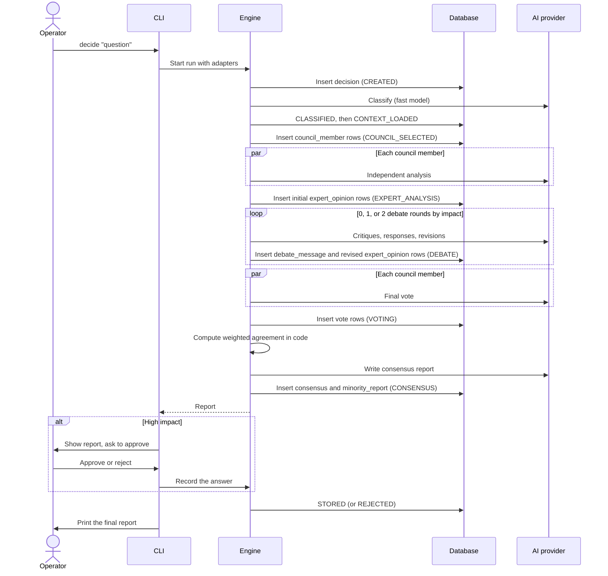

# System Design

How one decision runs through the MVP, how failures are handled, and the limits the MVP is built for. The MVP is a headless engine driven by a command-line interface ([ADR-018](../90-records/decisions/02-mvp-design.md#adr-018-the-mvp-is-a-headless-engine-with-a-cli)). Component responsibilities are in [System Architecture](system/README.md); the schema is in [Database Design](database-design.md). Run behavior is recorded in [ADR-014](../90-records/decisions/02-mvp-design.md#adr-014-mvp-decision-run-orchestration).

---

## Runtime components

| Component | Technology | Role in a decision run |
| --- | --- | --- |
| CLI | `apps/cli`, Node.js 24 with `util.parseArgs` and `readline` | Composition root. Parses commands, wires adapters into the engine, prints progress and reports, asks for approval |
| Engine | `packages/decision-engine`, `council`, `consensus`, `memory` | Runs the lifecycle, storing each stage before the next |
| AI provider layer | `packages/ai`, Vercel AI SDK behind `AIProvider` | Calls models; fast model for classification, reasoning model for experts, debate, and consensus |
| Database | PostgreSQL (local container or Neon branch), Drizzle ORM | Stores decisions and every stage's output |
| Observability | Pino, OpenTelemetry | Structured logs to a file; spans when an exporter is configured |

Sources: [AI](tech-stack/04-ai.md), [Data and Infrastructure](tech-stack/05-data-and-infrastructure.md), [Observability](tech-stack/06-observability.md).

---

## Commands

| Command | Does | Requirement |
| --- | --- | --- |
| `decide "<question>" [--context <text>] [--no-input]` | Runs a decision, prints each stage as it completes, prints the report, and asks for approval if impact is high. `--no-input` leaves it pending instead | FR-001, FR-019, FR-021 |
| `show <id>` | Prints the report, council, opinions, and debate summary | FR-021 |
| `list [--status <status>]` | Lists decisions, for example those awaiting approval | FR-024 |
| `approve <id>`, `reject <id>` | Resolves a pending high-impact decision | FR-019 |
| `resume <id>` | Continues an interrupted run from its last stored stage | FR-025 |
| `eval run <question-set>` | Runs every question through the council and a single-AI baseline. Writes a pairs file for raters and a separate key file, so raters stay blind | FR-023 |
| `eval score <ratings> <key>` | Reports the council's preference rate against the 60% target | FR-023 |

Human-readable output goes to stdout. Logs go to the log file, and `--verbose` mirrors them to stderr.

---

## Request lifecycle

The engine stores each stage's output before starting the next. The run's position is always `decision.status` plus the rows already written, which is what `resume` reads.

Stage notes:

- **Context** is the submitted question plus optional `--context` text. Retrieval of past decisions and documents starts in [Phase 3](../00-product/roadmap/05-phase-3-project-intelligence.md#context-retrieval).
- **Independent analysis** runs all council members in parallel. Debate starts only after every opinion is in or has failed ([Parallelism](system/05-pipeline-and-communication.md#parallelism)).
- **Debate rounds**: none for low impact, one for medium, two for high ([ADR-009](../90-records/decisions/02-mvp-design.md#adr-009-council-composition-scales-with-impact-level)).
- **Consensus** computes weighted agreement and groups votes in code, so the numbers are deterministic. The model only writes the reasoning, tradeoffs, risks, and minority reports.
- Every model output passes through a Zod schema before it is stored ([NFR-002](../00-product/requirements.md#non-functional-requirements)).
- Each stage transition emits a structured log event and an OpenTelemetry span: `DecisionStarted`, `ExpertCompleted`, `DebateStarted`, `ConsensusReached`, `ApprovalRequested`, `ApprovalGranted`, plus `DecisionFailed` ([Event Driven Architecture](system/05-pipeline-and-communication.md#event-driven-architecture)).

### Time budget

Targets from [NFR-007](../00-product/requirements.md#non-functional-requirements), split across stages so each step has its own timeout. Time waiting for the operator's approval is excluded.

| Stage | Low (15 s) | Medium (2 min) | High (5 min) |
| --- | --- | --- | --- |
| Classification and context | 4 s | 10 s | 15 s |
| Independent analysis | 10 s | 45 s | 75 s |
| Debate | — | 40 s | 150 s (2 rounds) |
| Voting and consensus | 1 s | 25 s | 60 s |

A step that exceeds its budget counts as a failed attempt and is retried as described below.

---

## Failure modes

Retries follow [Fault Tolerance](system/06-approval-fault-tolerance-logging.md#fault-tolerance): retry, fall back, report, continue if possible.

| Failure | Handling | Result |
| --- | --- | --- |
| Model call errors or times out | Retry up to 3 times with exponential backoff, then once on the fallback model | Expert counted as failed if all attempts fail |
| Model output fails Zod validation | Re-ask once with the validation errors, within the same retry budget | Treated as a failed call if still invalid |
| Classification fails | Retries as above | `FAILED`, reason recorded |
| Domain expert fails (low impact) | The single expert is required | `FAILED` |
| Expert fails (medium or high impact) | Continue if all three permanent experts and at least 3 domain experts produced opinions | Run continues; the report lists missing experts. Otherwise `FAILED` |
| Consensus step fails | Retries as above | `FAILED`; opinions and votes stay stored |
| CLI process is killed mid-run | Completed stages are already stored | `resume <id>` continues; no duplicated rows |
| Database unavailable | Retried like a model call | The CLI exits with an error; `resume <id>` continues once it is back |
| Operator leaves a high-impact decision unanswered (`--no-input` or quits) | Decision stays in `APPROVED` | Resolve later with `approve` or `reject` |
| Operator rejects a high-impact decision | Run ends without storing it as accepted | `REJECTED`; all reasoning stays stored |

A `FAILED` decision keeps every row written before the failure, so the cause can be inspected and the run counts toward the Technical success metric ([ADR-012](../90-records/decisions/02-mvp-design.md#adr-012-measurable-mvp-success-targets)).

Approvals for repository creation, push, deploy, migrations, and spending ([Human Approval System](../30-specs/eve/05-approval-and-workflows.md#human-approval-system)) arrive with execution, after the MVP.

---

## MVP limits

The MVP serves one operator and the evaluation set of at least 30 questions, not concurrent users.

| Limit | Value | Why |
| --- | --- | --- |
| Domain experts on a high-impact council | At most 8 (plus 3 permanent and Ethics Reviewer when needed) | Keeps a high-impact run inside 5 minutes |
| Debate rounds | 0 / 1 / 2 by impact | Fixed for the MVP; the deeper debate system comes with [Phase 2](../00-product/roadmap/03-phase-2-advanced-decision-engine.md#debate-system) |
| Parallel model calls | Set per provider rate limit in configuration | Avoids provider throttling, also during `eval run` |
| Users | One local operator, no accounts | Accounts arrive with the web app |

When any limit becomes the reason a target is missed, raise it through an ADR rather than in code alone.

---

## After the MVP: web app and API

In [Phase 2](../00-product/roadmap/03-phase-2-advanced-decision-engine.md#web-app-and-api), `apps/api` (Hono on Vercel Functions) and `apps/web` (Next.js on Vercel) call the same engine. What changes, per ADR-014:

- The API stores the decision and sends `decision/created`. An Inngest function runs the lifecycle as durable steps, with the decision id as the idempotency key, replacing `resume`.
- The web app polls decision status every 2 seconds while a run is in progress.
- Better Auth sessions and owner-scoped access apply ([ADR-016](../90-records/decisions/02-mvp-design.md#adr-016-mvp-security-baseline)).
- Limits add 2 concurrent runs per user and 20 submissions per user per day (Upstash Redis). Unanswered approvals expire as `REJECTED` after 30 days.
